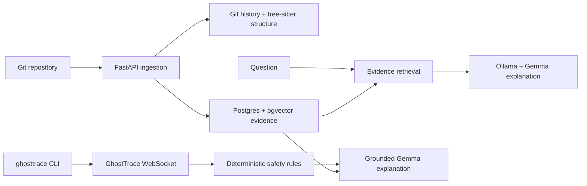
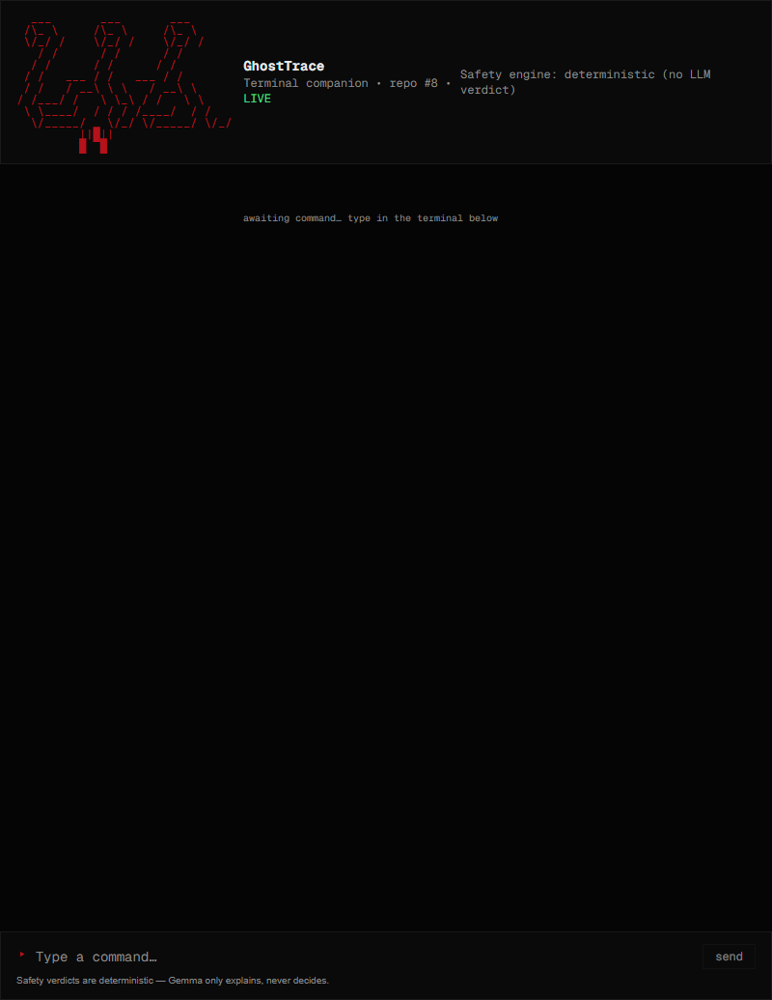

# Repo Séance: Code Archaeology for Abandoned Repositories

When a repository goes quiet, the source code alone rarely explains why.
Important context is scattered across commit messages, contributors, README
files, and the structure of the project. Repo Séance turns those traces into
evidence-backed answers—and adds GhostTrace, a local terminal companion that
warns before risky shell commands.

## The insight: history is evidence, not metadata

Git history is more than a timeline. It records who changed a project, what
they worked on, and where activity stopped. Repo Séance indexes that history
alongside repository files so answers can point back to concrete commits and
paths instead of sounding plausible without support.

The GhostTrace extension applies a related principle to command safety: the
verdict must be dependable before an explanation is generated. A deterministic
rule engine classifies a command as `SAFE`, `CAUTION`, or `DESTRUCTIVE`.
Gemma can explain the result using repository context, but it never chooses or
overrides the verdict. The CLI sends command text to the API; it does not run
the command.

## How it works



Ingestion clones a repository, records commit history and contributor
statistics, scans its structure, extracts symbols, and indexes selected
evidence. The `/ask` endpoint retrieves relevant evidence with pgvector and
asks the local model to cite real file paths and commit hashes. The CLI and
browser preview both use the same GhostTrace WebSocket, safety rules, and
explanation path.

## Engineering decisions

- **A compatible parser stack:** `tree-sitter` stays pinned to `0.21.3`
  because `tree-sitter-languages` 1.10.2 depends on that API. Upgrading the
  parser broke the existing language-package integration.
- **History by default:** the first clean demo import used a one-commit
  shallow clone, which hid the chronology the tool is meant to explain. The
  default now keeps the full history of the default branch; setting
  `CLONE_DEPTH` to a positive number opts back into a shallow clone.
- **Windows-safe clone cleanup:** Git pack files can be read-only on Windows.
  Cleanup clears the read-only attribute before retrying deletion, preventing
  a failed or oversized clone from leaving a half-removed worktree behind.
- **Safety before language generation:** GhostTrace's verdict is computed
  deterministically before any model call. This keeps command classification
  available even when Ollama is stopped and prevents a model from softening a
  dangerous result.
- **A model that fits the machine:** `gemma2:2b` is the practical local model
  for the tested RTX 4050 with 6 GB VRAM. This machine reported CPU inference,
  at roughly 23 seconds per generation; the demo allows that response time
  rather than hiding it.
- **Two interfaces, one product path:** the horror-styled web terminal is a
  visual preview, while `pip install -e packages/ghosttrace-cli` installs the
  actual `ghosttrace` command. Both call the same backend instead of
  duplicating rules in the client.

## Demo walkthrough

The rehearsal imported the public repository fresh with full history. The
import completed with 18 commits. A composite question about what happened to
the project and who worked on it returned citations to its README and a real
commit. Then the CLI classified three commands live:

```text
rm -rf ./build   -> DESTRUCTIVE
rm old_note.txt  -> CAUTION
ls -la           -> SAFE
```

Each result included evidence references from the imported repository, such
as `commit:60186a9a` and `commit:fbca8b87`. Those hashes are examples from the
rehearsal, not permanent identifiers.

The browser terminal remains useful as a quick visual preview; the installable
CLI is the command-line product used for the safety demonstration.



*The browser preview shows the live WebSocket status and terminal styling.
The demo's command classifications are run through the installable CLI.*

## What is implemented—and what is not

Implemented: repository cloning and structure analysis; commit and contributor
history; symbol extraction; pgvector evidence retrieval; cited `/ask`
responses; an experimental `/roadmap` endpoint; and GhostTrace's deterministic
classifier, grounded explanation, WebSocket, browser preview, and installable
CLI.

The `/roadmap` endpoint is not part of the demo because its live output gave
generic recommendations and incorrectly described the repository as a
GhostTrace project. It needs better grounding before being presented as a
reliable project roadmap.

Explicitly descoped for this sprint: ZIP upload, Render deployment, and full
hybrid retrieval. Retrieval currently uses pgvector semantic evidence plus
separate history-derived signals; it does not combine vector and keyword
search with a hybrid ranking strategy. There is no hosted demo deployment.

Sentry instrumentation is optional and reads its DSN from `.env`. The local
instrumentation was verified with an in-memory Sentry transport, including a
captured model-call span and a sanitized failure event. No Sentry project DSN
was configured during rehearsal, so delivery to a remote Sentry dashboard has
not been verified.

## What works offline

After dependencies and model weights have been downloaded and a repository is
already available locally, the API, Postgres/pgvector retrieval, GhostTrace
classification, and Gemma explanations run on the local machine without a
network connection. Cloning a repository from GitHub requires internet
access. Initial dependency and model downloads also require internet unless
they are already cached. Optional Sentry event delivery requires a configured
DSN and network access.
